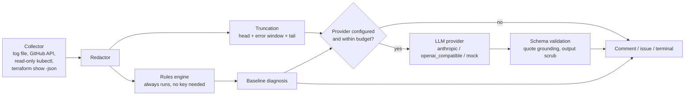
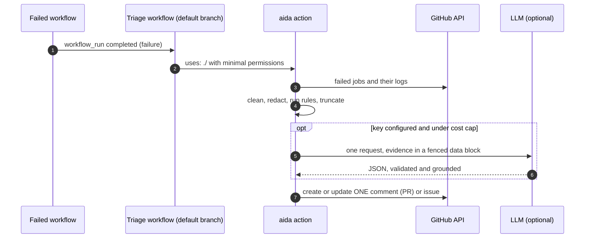
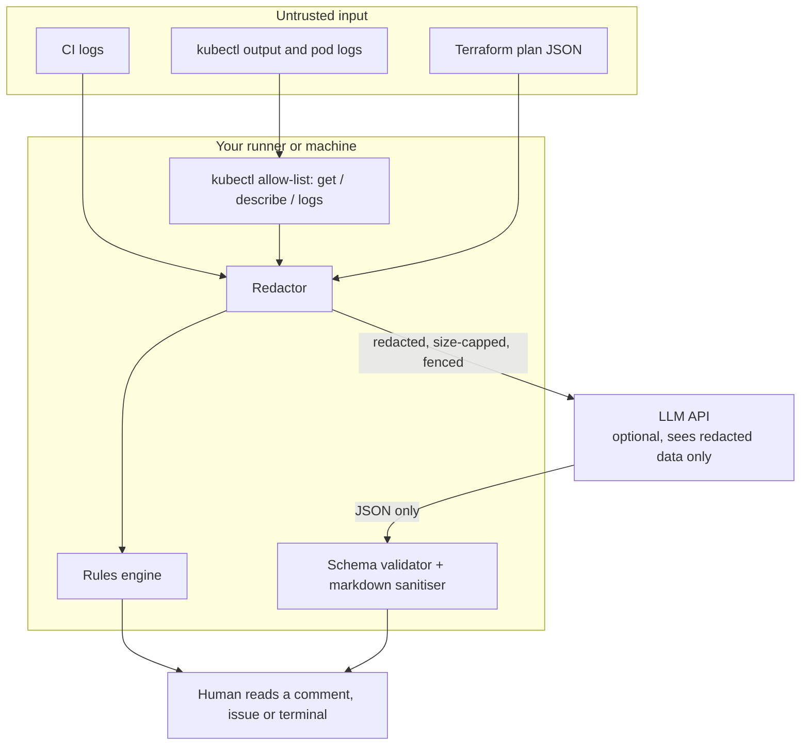

# ai-devops-assistant

[](https://github.com/rsk071216-stack/ai-devops-assistant/actions/workflows/ci.yml)
[](LICENSE)


**An AI assistant for DevOps failures that keeps humans in control.** It triages failed GitHub Actions runs, diagnoses
unhealthy Kubernetes workloads and reviews Terraform plans. A deterministic rules engine always produces a baseline
diagnosis with no API key; an LLM (Anthropic, any OpenAI-compatible endpoint, or a mock for tests) adds depth for
failures no rule knows. Secrets are redacted before anything leaves the machine, logs are treated as hostile input,
the Kubernetes collector is read-only by construction, and every change is gated by an offline evaluation suite.

> Not a toy "paste logs into a chatbot" demo: the interesting parts are the safety and testing design, described below
> and pinned by 290 automated tests.

## The problem this solves

- Engineers lose hours scrolling through 10,000-line logs to find the one line that matters, and on-call fatigue makes
  that worse at 3 a.m.
- The obvious fix, sending logs to an LLM, raises real concerns: tokens and connection strings in logs, prompt
  injection from attacker-controlled text, hallucinated "fixes", unbounded cost, and tools that quietly gain write access.

This project answers those concerns in the design rather than in a disclaimer: see [Security & privacy](#security--privacy)
and the [threat model](docs/threat-model.md).

## Architecture



CI triage as a sequence (the consumer workflow uses `workflow_run`, so untrusted PR code never gets a write token):



Trust boundaries:



## Features

| Feature | What it does | Verified by CI |
| --- | --- | --- |
| CI failure triage | Downloads failed jobs' logs (or reads a file), redacts, extracts the error window, classifies (17 CI categories), proposes a concrete fix, posts **one** updating PR comment or issue | Unit tests with a fake GitHub API, eval suite |
| Kubernetes diagnosis | Collects read-only evidence (describe, events, previous logs, owner chain, limits, probes, Services/Endpoints, missing ConfigMap/Secret refs); recognises CrashLoopBackOff, OOMKilled, ImagePullBackOff, probe failures, Pending (resources, taints, affinity, PVC), selector mismatches, missing config; returns exact `kubectl`/YAML fixes | Fixture bundles, read-only guarantees |
| Terraform plan review | Highlights destroys/replacements, public exposure and IAM widening in plain English, deterministic checks first | Plan fixtures |
| Provider interface | `anthropic` (official SDK, schema-constrained output), `openai_compatible` (httpx), `mock` (tests) | Fake clients, HTTP mock transport |
| Redaction | AWS, Azure, GitHub, GitLab, npm, PyPI, Slack, Stripe, Anthropic/OpenAI keys, JWTs, PEM keys, URL passwords, connection strings, K8s Secret data, entropy catch-all | 70-case corpus generated at test time |
| Injection defenses | Fenced data blocks, strict output schema, quote grounding, inert rendering, no execution anywhere | Payload suite + "no process spawned" guard |
| Evaluation harness | 69-case golden dataset, per-category accuracy, CI regression gate, job-summary table | Runs on every push |
| Observability | Structured JSON logs (metadata only), token and cost counters, `--explain` evidence trail | Tests |
| MCP server (optional) | Exposes the read-only tools to MCP clients | Tool list asserted |
| Supply chain | SHA-pinned actions, `uv.lock`, digest-pinned base image, Trivy, cosign-signed GHCR image, Dependabot with cooldown | CI |

## What makes this different

1. **Rules first, LLM second.** Useful and fully testable with no API key. The model is an upgrade, not a dependency.
2. **Security is structural, not a prompt.** Redaction before egress, untrusted-input handling, read-only collector,
   cost caps, human-in-the-loop output: each one has tests that fail if the property is lost.
3. **Honest evaluation.** A committed golden dataset gates CI; the docs say exactly what the numbers do and do not mean.
4. **Grounded answers.** Model quotes are verified against the input; unverifiable ones are dropped and confidence is capped.
5. **Adoptable.** A composite action with a documented minimal-permissions block, plus a signed container image.

## Sample output

Produced by the real tool in rules-only mode (no API key) from [`docs/examples/inputs/k8s-oomkilled-bundle.json`](docs/examples/inputs/k8s-oomkilled-bundle.json).
More: [CI comment](docs/examples/ci-triage-comment.md), [Kubernetes OOMKilled](docs/examples/k8s-oomkilled-diagnosis.md),
[Terraform review](docs/examples/tf-review.md).

````markdown
## Kubernetes diagnosis: Container `api` was OOMKilled (memory limit 128Mi)

Category: `oom_killed` | Confidence: **high** | Mode: **rules-only**

### Root cause

Container `api` was killed by the kernel OOM killer (exit code 137): it used more memory than its limit of 128Mi.
It restarts repeatedly, which shows up as CrashLoopBackOff.

### Suggested fix

1. Raise the memory limit of `api` (suggested 256Mi, double the current limit) as a short-term fix.
2. Measure real usage over a representative period before settling on a number.
3. If usage grows without bound, investigate a leak or unbounded cache/queue instead of only raising the limit.

Suggested commands (review before running, nothing is executed for you):

    kubectl -n prod top pod --containers
    kubectl -n prod set resources deployment/api -c api --limits=memory=256Mi

Suggested change (illustrative diff, apply by hand):

       resources:
         limits:
    -      memory: 128Mi
    +      memory: 256Mi
````

### Live proof: the action triaging a real failed run

The [Demo failure](.github/workflows/demo-failure.yml) workflow (manual dispatch only, never on push) fails on purpose.
The [Triage CI failures](.github/workflows/triage-example.yml) workflow then ran this repository's own action in
**rules-only mode** and opened this issue: **DEMO_ISSUE_URL**

## Quick start

### 1. Locally, offline, rules-only

```bash
# needs uv (https://docs.astral.sh/uv/); Python 3.12 is installed by uv
uv sync --frozen
uv run aida ci-triage    --log-file docs/examples/inputs/ci-failure.log --rules-only --explain
uv run aida k8s-diagnose --fixture docs/examples/inputs/k8s-oomkilled-bundle.json --rules-only
uv run aida tf-review    docs/examples/inputs/tf-plan-ssh-open.json --rules-only
uv run aida redact build.log          # see exactly what would be sent to a model
```

Against a live cluster (read-only, uses your kubeconfig):

```bash
uv run aida k8s-diagnose deployment/api -n prod --save-bundle bundle.json
```

### 2. With an API key

```bash
export ANTHROPIC_API_KEY=...                  # your key, never committed
uv run aida ci-triage --log-file build.log    # default model: claude-sonnet-5-5 (override with --model)
```

Any OpenAI-compatible endpoint (vLLM, Ollama, a gateway) works with `AIDA_OPENAI_BASE_URL` and `--provider openai_compatible`.
Without a key the tool prints a clear notice and stays in rules-only mode.

### 3. As a GitHub Action

```yaml
name: Triage CI failures
on:
  workflow_run:
    workflows: ["CI"]
    types: [completed]
permissions: {}
jobs:
  triage:
    if: github.event.workflow_run.conclusion == 'failure'
    runs-on: ubuntu-24.04
    permissions:
      actions: read          # read the failed jobs' logs
      contents: read
      issues: write          # runs without a PR
      pull-requests: write   # the single updating PR comment
    steps:
      - uses: rsk071216-stack/ai-devops-assistant@<commit-sha>   # pin by SHA
        with:
          anthropic-api-key: ${{ secrets.ANTHROPIC_API_KEY }}    # optional; omit for rules-only
```

A working copy lives in [`triage-example.yml`](.github/workflows/triage-example.yml). Do not check out or run the failing
PR's code in this job.

### 4. Container and MCP

```bash
docker run --rm ghcr.io/rsk071216-stack/ai-devops-assistant:main ci-triage --help   # signed with cosign (keyless)
uv sync --frozen --all-extras && uv run aida-mcp                                     # stdio MCP server
```

Claude Desktop / Claude Code client config:

```json
{
  "mcpServers": {
    "ai-devops-assistant": {
      "command": "uv",
      "args": ["run", "--frozen", "--all-extras", "--project", "/path/to/ai-devops-assistant", "aida-mcp"]
    }
  }
}
```

The MCP tools are rules-only and read-only (`triage_ci_log`, `diagnose_k8s_workload`, `diagnose_k8s_bundle`,
`review_terraform_plan`, `redact_text`); your client's model does the reasoning over redacted, structured evidence.

## Configuration

| Setting | Default | Purpose |
| --- | --- | --- |
| `ANTHROPIC_API_KEY` | unset | Enables the Anthropic provider |
| `--provider` | `auto` | `auto`, `anthropic`, `openai_compatible`, `mock`, `none` |
| `--model` / `AIDA_MODEL` | `claude-sonnet-5-5` | Model id |
| `AIDA_OPENAI_BASE_URL`, `AIDA_OPENAI_API_KEY` | unset | OpenAI-compatible backend |
| `--rules-only` | off | Never call a model |
| `--llm-when` | `always` | `unknown` = only when no rule matched confidently |
| `--max-log-bytes` | 24000 | Evidence sent to a model |
| `--max-cost-usd` | 0.10 | Per-run worst-case cap; call skipped above it |
| `--explain` | off | Evidence trail in the output |
| `--post` | `none` (`auto` in the action) | `pr`, `issue` or `auto` |

Full reference: [docs/configuration.md](docs/configuration.md).

## Security & privacy

Summary of the [threat model](docs/threat-model.md); every control has a test that fails if the property is lost.

- **Secrets never leave the machine unredacted.** Redaction runs before rules, rendering and any model call, and again
  on model output. Only counts are logged.
- **Logs are untrusted.** Evidence is confined to a randomly-identified, fenced data block; the system prompt says it is data;
  the reply must match a strict schema; quoted evidence must literally appear in the input; markdown from logs or the
  model is neutralised (no image beacons, links, mentions or HTML); **nothing returned by a model is ever executed.**
- **Read-only.** The kubectl wrapper allows `get`, `describe` and `logs` only, rejects everything else before spawning a
  process, and can only check that a Secret exists, never read it.
- **Bounded spend.** One model call per run, input and worst-case cost checked first, log truncation keeps the head,
  the error windows and the tail.
- **Human in the loop.** Output is a comment, an issue or text. Patches are diffs to apply by hand.

**Evaluation method.** `aida eval` scores a 69-case golden dataset (42 CI logs, 20 Kubernetes bundles, 7 Terraform
plans) for category and key fix elements, in `rules` and `mock` modes, and CI fails below the committed thresholds.
Offline results (these are **not** live-model measurements; see [docs/evals.md](docs/evals.md)):

| Mode | Cases | Category accuracy | Fix elements | Cases the rules cover | Novel cases |
| --- | ---: | ---: | ---: | ---: | ---: |
| rules-only | 69 | 89.9% | 89.9% | 100% | 0% (by design) |
| mock LLM (recorded answers) | 69 | 100% | 100% | 100% | 100% |

**Honest limits.**

- The dataset is synthetic and written alongside the rules, so 100% on covered cases is a regression result, not a
  production accuracy claim. Real logs will expose gaps; add them to the dataset.
- The mock column only proves the pipeline works; it says nothing about model quality. No live-model accuracy is
  claimed, because none has been measured. You can measure your own with the manual live-eval workflow.
- LLM answers can be wrong or confident-sounding nonsense. The report shows rules and model separately, caps
  confidence when quotes cannot be verified, and says so. **Always review before acting.**
- Redaction is pattern-based; an unlabeled, low-entropy secret can slip through. Use `--rules-only` for the most
  sensitive repositories.
- It diagnoses; it does not remediate, and it cannot see what is not in the logs or evidence.

### What CI verifies automatically, and what needs a key or a cluster

| Capability | Verified in CI (no secrets) | Needs a real API key or cluster |
| --- | --- | --- |
| Redaction, injection handling, rendering, guardrails | Yes | - |
| Rules engines and the golden dataset (rules, mock) | Yes | - |
| GitHub client, one-comment-updating logic, CLI | Yes (fake API) | - |
| End-to-end action in rules-only mode | Via the manual demo run (linked above) | - |
| kubectl read-only enforcement | Yes (validation + fake runner) | Running against a real cluster is manual |
| Anthropic provider request shape and error handling | Yes (fake client) | Real model quality and latency: manual live eval |
| OpenAI-compatible provider | Yes (HTTP mock transport) | A real endpoint |
| Container build, Trivy scan, signed push to GHCR | Yes | - |

## Cost guidance

All figures are **estimates**; check current provider pricing.

- Default evidence cap is 24 KB, about 6k tokens, plus roughly 1k tokens of instructions and baseline: **about 7k input
  tokens and a few hundred output tokens per triage**.
- At the price table bundled for `claude-sonnet-5-5` ($2 / $10 per million input / output tokens) that is on the order of
  **$0.01 to $0.03 per model-assisted triage**. Rules-only runs cost nothing.
- Guardrails cap the worst case: one call per run, an input-token budget, a worst-case cost check against
  `--max-cost-usd` *before* the call, and `--llm-when unknown` to skip the model whenever a rule already knows the answer.
- Every report prints the token counts and an estimated cost for the call it made.

## Design decisions

| ADR | Decision |
| --- | --- |
| [0001](docs/adr/0001-rules-first-llm-second.md) | Rules first, LLM second |
| [0002](docs/adr/0002-provider-abstraction-and-structured-output.md) | Provider interface and schema-constrained output |
| [0003](docs/adr/0003-redaction-before-egress.md) | Redact before anything leaves the machine |
| [0004](docs/adr/0004-read-only-by-construction.md) | Read-only by construction |
| [0005](docs/adr/0005-eval-gated-ci.md) | Eval-gated CI with honest offline numbers |
| [0006](docs/adr/0006-workflow-run-composite-action-single-comment.md) | `workflow_run`, composite action, one updating comment |

More: [architecture](docs/architecture.md), [threat model](docs/threat-model.md), [evals](docs/evals.md),
[configuration](docs/configuration.md).

## Repository layout

```text
action.yml                    composite GitHub Action (ci-triage)
src/ai_devops_assistant/      redaction, guardrails, rules, providers, k8s, terraform, evals, CLI, MCP server
evals/                        golden dataset, recorded mock answers, committed thresholds
tests/                        290 tests: redaction corpus, injection payloads, read-only guarantees, CLI, providers
docs/                         architecture, threat model, evals, configuration, ADRs, generated examples
.github/workflows/            ci, demo-failure (manual), triage-example, eval-live (manual)
Dockerfile                    digest-pinned, non-root image
```

## Roadmap

- More signatures from real incidents (Helm/Kustomize errors, Azure DevOps and Jenkins logs, Argo CD sync failures).
- Hold-out evaluation set built from anonymised real failures, so the offline score can say something about generalisation.
- Cluster-side evidence for admission and policy denials; Service/NetworkPolicy reachability checks.
- Prompt-cache friendly request layout and a batch mode for scheduled triage of flaky-test backlogs.
- SARIF output so findings can appear in code scanning.

## How I can apply this to your team

I am a freelance Cloud DevOps engineer (9+ years; Azure and AWS, Kubernetes, GitHub Actions, Terraform). Typical ways this
work turns into an engagement:

- **Pilot in your pipelines:** wire the action into your CI, tune the rules to your stack and failure history, and measure
  the time saved on on-call.
- **Build your eval set:** turn your own incident history into a regression dataset so every change to rules or prompts is gated.
- **Private or regional models:** point the OpenAI-compatible backend at a model endpoint inside your cloud boundary, with the
  same redaction, schema and cost guardrails.
- **Security review of AI tooling:** threat-model and harden an existing "LLM reads our logs" integration.

Open an issue on this repository or reach out through my GitHub profile.

## License

MIT, see [LICENSE](LICENSE). Copyright (c) 2026 Raees Khan.
