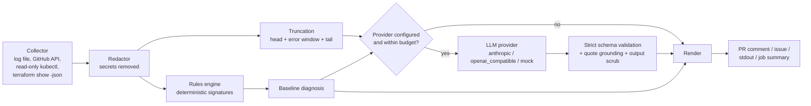
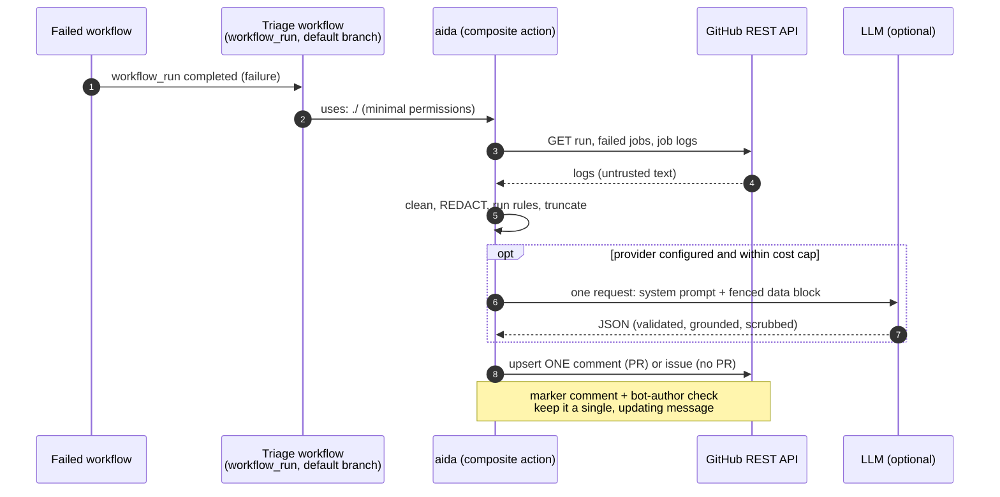
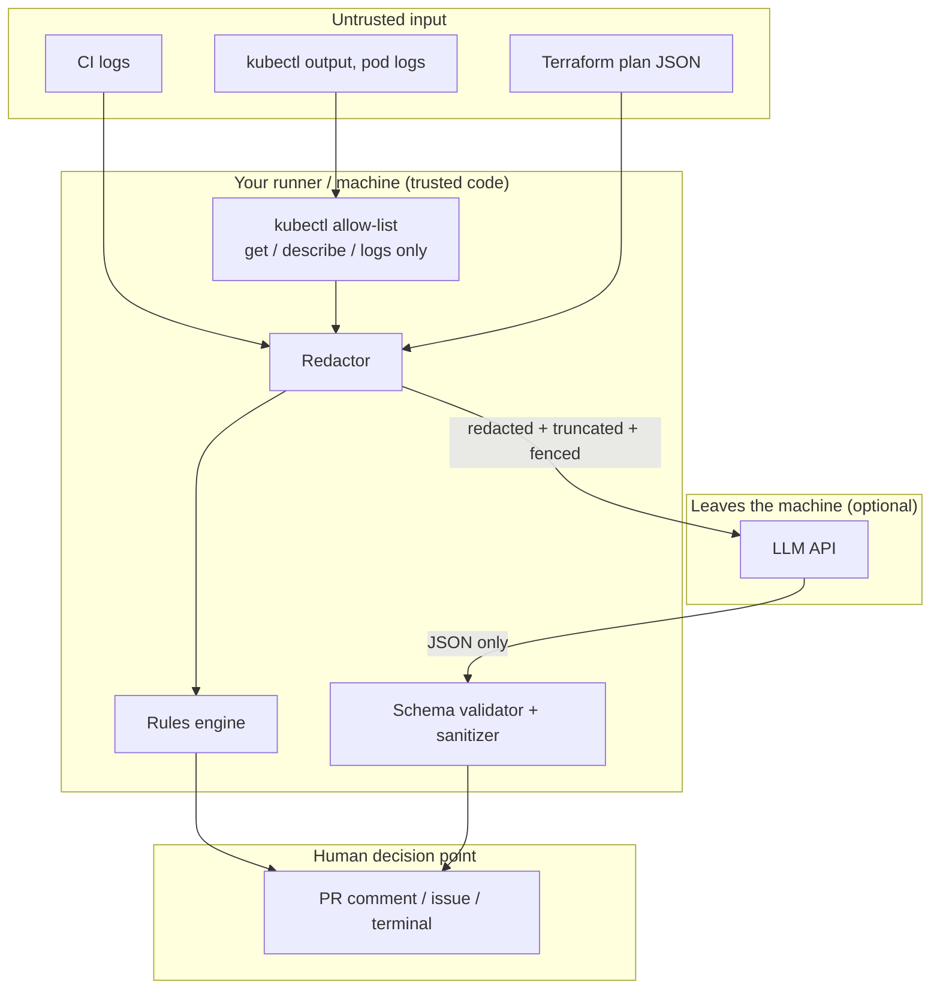

# Architecture

`ai-devops-assistant` (CLI name `aida`) diagnoses CI failures, Kubernetes problems and Terraform plan risk.
The design goal is a tool that is **useful with no API key, safe to point at untrusted logs, and testable offline**.

## Pipeline

Every analyzer (CI, Kubernetes, Terraform) ends in the same tail, implemented once in
[`analysis.py`](../src/ai_devops_assistant/analysis.py).

Key properties:

- The **rules engine always runs** and always produces the baseline. If there is no key, the model is over budget,
  the provider errors, or its reply fails validation, the user still gets the rules result plus a clear notice.
- The model sees **redacted, truncated** evidence only, inside a delimited data block.
- The model's reply must match a strict pydantic schema (`extra="forbid"`, enum categories, bounded lengths).
  Quoted evidence is checked mechanically against the input; ungrounded quotes are dropped and confidence is capped.
- Nothing the model returns is ever executed. Suggested commands are printed in a code block, and risky-looking ones
  are flagged.

## CI triage sequence

## Trust boundaries

The only egress of log-derived data is the redacted, size-capped request to the model provider you configured.
There is no code path that writes to a cluster, a repository or a file other than the comment/issue body.

## Modules

| Module | Responsibility |
| --- | --- |
| `redaction.py` | Ordered, named redaction rules + entropy catch-all; idempotent; reports counts only |
| `guardrails.py` | ANSI/timestamp cleaning, head + error-window + tail truncation, per-run `Budget` |
| `engine.py`, `ci/rules.py` | Declarative signature engine and the CI failure signatures |
| `k8s/collector.py` | The only subprocess use in the package; allow-listed read-only kubectl |
| `k8s/facts.py`, `k8s/rules.py` | Normalise JSON or `describe` text into facts; Kubernetes failure analysis |
| `terraform/review.py` | Deterministic plan checks: destroy/replace, public exposure, IAM widening |
| `providers/` | `anthropic`, `openai_compatible`, `mock` behind one `complete()` interface |
| `prompts.py` | System prompt, fenced data block, strict request schema |
| `analysis.py` | Budget check, provider call, validation, grounding, merge into one `Diagnosis` |
| `sanitize.py`, `render.py` | Neutralise untrusted text for markdown; render comments |
| `ci/github.py` | Minimal REST client; one updating comment/issue, bot-author check |
| `evals/runner.py` | Golden-dataset scorer and regression gate |
| `mcp_server.py` | Optional MCP server exposing the read-only tools |

## Decisions

See the [ADR index](adr/README.md). Security details are in the [threat model](threat-model.md); how the numbers
are produced and what they do not mean is in [evals](evals.md).
